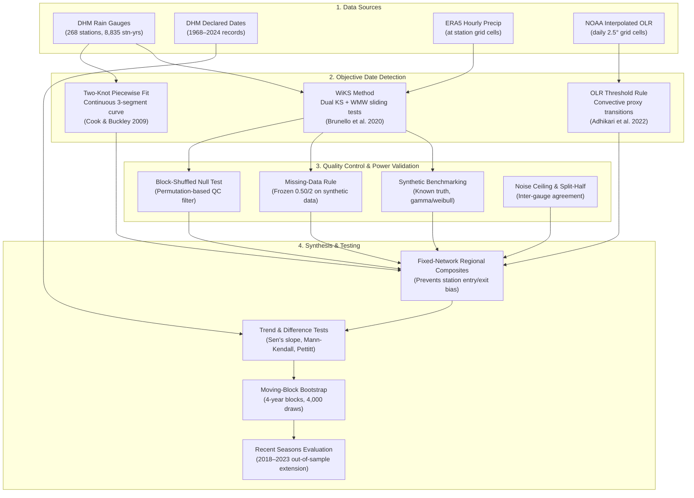
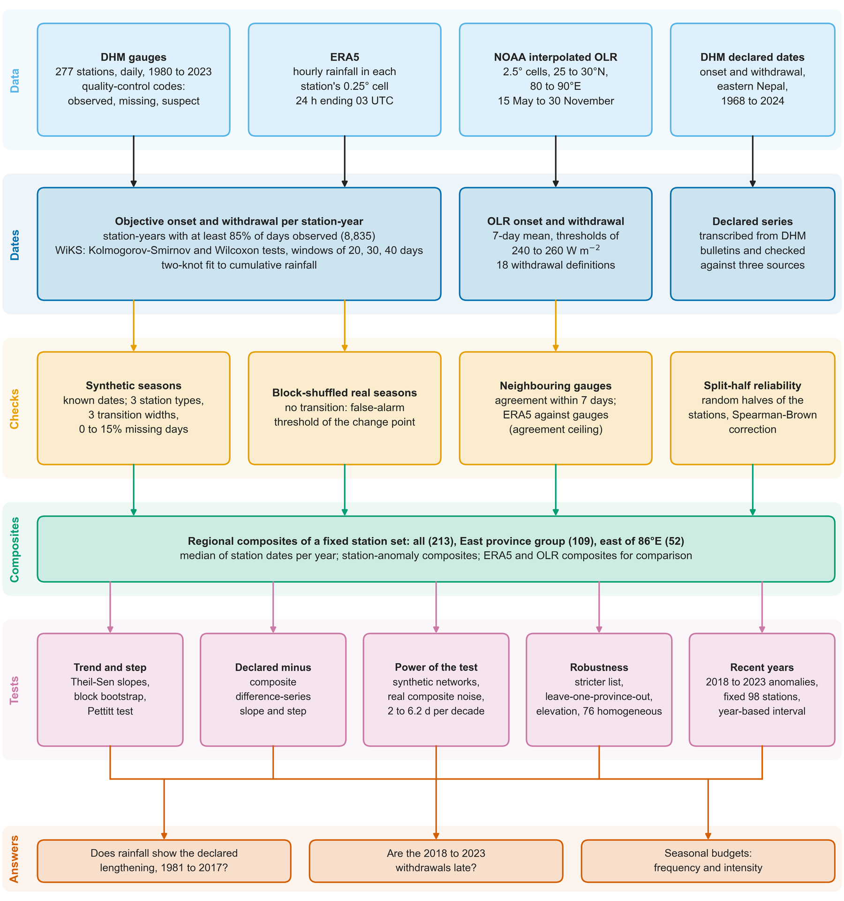

<div align="center">

# 🌧️ nepal_monsoon_timing

### Testing Nepal's Declared Summer Monsoon Calendar Against Multi-Source Rainfall Observations (1981–2023)

*A rigorous empirical assessment of operational monsoon onset and withdrawal dates using 268 quality-controlled rain gauges, ERA5 atmospheric reanalysis, and NOAA satellite outgoing longwave radiation.*

[](https://www.python.org/)
[](#)
[](https://creativecommons.org/licenses/by/4.0/)
[](LICENSE)
[](https://www.dhm.gov.np)
[](https://orcid.org/0009-0009-8669-4245)
[](https://orcid.org/0009-0009-8669-4245)

---

**Author & Principal Investigator:** [Somnath Luitel](https://orcid.org/0009-0009-8669-4245)  
*Department of Earth, Environmental, and Atmospheric Sciences, Western Kentucky University, Bowling Green, KY, USA*  
📫 `somnathluitel360@gmail.com` · 🌐 GitHub: [@shreesomnath](https://github.com/shreesomnath)

---

</div>

## 📌 Overview & Scientific Context

Every summer, Nepal's **Department of Hydrology and Meteorology (DHM)** officially announces when the South Asian Summer Monsoon arrives (onset) and departs (withdrawal). Operationally, these milestone dates have historically been determined through expert synoptic map inspection (such as isobaric analysis, wind field shifts, and satellite cloud imagery) rather than by applying an objective, quantitative rule to surface rainfall measurements.

The official declared record suggests a dramatic change in Nepal's climate over the past four decades:
- An apparent **lengthening of the monsoon season** driven by a declared withdrawal delay of **+6.2 days per decade** (1981–2017).
- A sharp **step-like delay of +12.5 days** in declared withdrawal after 1997.

**This study asks three fundamental questions:**
1. **Do objective rainfall dates reproduce the declared trend and step for 1981–2017?**  
   *Does the ground rain gauge network or high-resolution reanalysis corroborate the operational lengthening signal?*
2. **How reliable are local objective dates, and what does this mean for comparing products?**  
   *What is the noise floor, spatial coherence, and statistical power of objective transition metrics across complex Himalayan topography?*
3. **Do recent seasons (2018–2023) agree with the declared dates?**  
   *Are the prominent late withdrawals reported in recent years real physical anomalies across all independent observing systems?*

---

## 🔬 Key Scientific Findings

| Line of Evidence | 1981–2017 Withdrawal Trend | Post-1997 Step Change | Correlation ($r$) with Declared | 2018–2023 Anomaly (vs. 1981–2017) |
|---|:---:|:---:|:---:|:---:|
| **DHM Declared Dates** | **+6.2 days/decade** | **+12.5 days** | *Reference* | **+13.6 days** |
| **Rain Gauges (WiKS, All 213)** | **-2.9 days/decade** | **-4.7 days** | **-0.05** | **+9.8 days** |
| **Rain Gauges (Two-knot, All 213)** | **-2.0 days/decade** | **-4.2 days** | **+0.07** | *N/A* |
| **ERA5 Reanalysis (WiKS, All 213)** | **+1.7 days/decade** | **+1.1 days** | **+0.23** | **+5.9 days** |
| **NOAA Satellite OLR (4 cells)** | **+0.2 days/decade** | **+3.0 days** | **+0.29** | **+12.0 days** |

1. **Historical Disconnect (1981–2017):**
   - Quality-controlled surface rain gauges exhibit **no lengthening trend** and **no post-1997 step delay** in monsoon withdrawal. Gauge-derived withdrawal trends are slightly negative (-2.9 days/decade for WiKS; -2.0 days/decade for two-knot fits), showing zero correlation ($r = -0.05$) with the declared series.
   - Direct difference tests ($[\text{Declared}] - [\text{Gauge}]$) yield a statistically significant positive divergence of **+6.7 days per decade** ($p = 0.0095$) and a step difference of **+17.2 days** ($p < 0.01$).
   - This indicates that the historical lengthening reported in official declarations was an artifact of operational synoptic declaration criteria rather than a shift in actual ground precipitation.

2. **Recent Physical Delay (2018–2023):**
   - In stark contrast to the historical record, the anomalously late monsoon withdrawals observed from 2018 to 2023 are **physically real and corroborated across all lines of evidence**: gauges (+9.8 days), ERA5 (+5.9 days), and satellite OLR (+12.0 days).

3. **Pre-Monsoon & Seasonal Rainfall Budgets:**
   - WiKS-bounded seasonal totals show that pre-monsoon rainfall has increased across Nepal, while core monsoon season duration remained stable over the historical baseline.

---

## 🗺️ Methodological Architecture & Workflow

The complete analytical pipeline is structured into four interconnected tiers:



<p align="center">
  
</p>

---

## 📁 Repository Structure

```
nepal_monsoon_timing/
├── code/                      # Python analysis pipeline (steps 50–79, 82)
│   ├── config.py              # Frozen study parameters, paths, and detection rules
│   ├── wiks.py                # Core WiKS dual-test change-point detection algorithm
│   ├── cb.py                  # Cook-Buckley two-knot cumulative rainfall model
│   ├── 50_wiks_synthetic.py   # Benchmark on synthetic seasons with known truth
│   ├── 50b_wiks_missing_rule.py # Missing-data tolerance selection
│   ├── 50c_wiks_aggregation.py  # Window p-value aggregation sensitivity
│   ├── 51_wiks_stations.py    # Station date extraction (1981–2017)
│   ├── 51b_wiks_2018_2023.py  # Out-of-sample station extension (2018–2023)
│   ├── 52_dhm_declared_dates.py # Operational DHM record compilation
│   ├── 53_wiks_null_qc.py     # Block-shuffled null quality control
│   ├── 54_era5_wiks_compare.py # ERA5 extraction and gauge comparison
│   ├── 55_trends_budget.py    # Theil-Sen trends and seasonal rainfall budgets
│   ├── 56_apply_qc.py         # Apply null-based QC filter to station dates
│   ├── 57_diagnose_qc.py      # QC diagnostic and low-elevation response
│   ├── 58_robustness.py       # Fixed vs. variable network robustness
│   ├── 59_trend_recovery.py   # Synthetic trend injection and recovery power
│   ├── 60_figures.py          # Primary publication figures (600 dpi PNG & vector PDF)
│   ├── 61_definition_sensitivity.py # Two-knot fit sensitivity analysis
│   ├── 62_power_real_noise.py # Statistical power evaluation using empirical noise
│   ├── 63_fetch_olr.py        # HTTP range-read fetch of NOAA OLR for Nepal
│   ├── 63b_fetch_olr_2018_2022.py # OLR extension through 2022
│   ├── 64_olr_checks.py       # OLR onset and withdrawal date extraction
│   ├── 65_olr_replicate.py    # Replication of published OLR onset criteria
│   ├── 66_figure_olr.py       # OLR check figures
│   ├── 67_more_validation.py  # Split-half reliability and 1997 shift tests
│   ├── 68_olr_sensitivity.py  # Parameter sensitivity sweep (900 configurations)
│   ├── 69_recent_years.py     # 2018–2023 withdrawal anomaly analysis
│   ├── 70_figure_recent.py    # Recent years multi-source comparison figure
│   ├── 71_declared_difference_tests.py # Formal tests of (Declared - Gauge) series
│   ├── 72_synthetic_recovery_100.py # Multi-replicate recovery experiment (100 realizations)
│   ├── 74_recent_year_based.py # Year-based confidence intervals
│   ├── 75_anomaly_composites_and_loyo.py # Station-anomaly composites & LOYO tests
│   ├── 76_block_bootstrap_composite_slopes.py # 4,000-draw moving-block bootstrap
│   ├── 77_table3.py           # Synthesis Table 3 generation
│   ├── 78_figure1_network.py  # Station network and spatial distribution figure
│   ├── 79_karki_homogeneous_subset.py # Sensitivity to Karki et al. (2017) network
│   └── 82_figure_workflow.py # Methodological workflow diagram generator
├── docs/                      # Documentation assets and diagrams
│   └── workflow.png           # Rendered workflow diagram
├── inputs/                    # Small public input subsets
│   ├── olr_nepal_1981_2017.csv# NOAA PSL interpolated OLR (1981–2017)
│   └── olr_nepal_2018_2022.csv# NOAA PSL interpolated OLR (2018–2022)
├── outputs/                   # 60+ derived tables (dates, composites, trends, tests)
│   ├── anomaly_composites.csv
│   ├── budget_station_seasons.csv
│   ├── cb_station_dates.csv
│   ├── declared_vs_gauge_all.csv
│   ├── dhm_declared_dates.csv
│   ├── diff_series_tests.csv
│   ├── recent_years_summary.csv
│   ├── table3_lengthening_test.md
│   ├── table3_lengthening_test.csv
│   ├── wiks_station_dates_qc.csv
│   └── ...
├── requirements.txt           # Python dependency specifications
├── CITATION.cff               # Citation File Format metadata
└── README.md                  # Comprehensive repository documentation
```

---

## 🔎 Detailed Script Pipeline Guide

<details>
<summary><b>Click to expand script pipeline reference (Steps 50 to 82)</b></summary>

| Stage | Scripts | Objectives & Operational Steps | Key Outputs |
|---|---|---|---|
| **Synthetic Validation** | `50`, `50b`, `50c` | Benchmarks WiKS on synthetic rainfall with known onset/withdrawal across 3 climate regimes (humid, dry west, high mountain). Sweeps missing-data tolerance (0–25%) and evaluates geometric vs. arithmetic $p$-value averaging. | `wiks_synthetic.csv`, `wiks_missing_rule.csv`, `wiks_aggregation.csv` |
| **Station Date Extraction** | `51`, `51b`, `52`, `54` | Runs WiKS across 268 DHM rain gauges for 1981–2017 and 2018–2023. Transcribes official DHM declared dates (1968–2024). Extracts co-located ERA5 daily rainfall dates. | `wiks_station_dates.csv`, `wiks_station_dates_2018_2023.csv`, `dhm_declared_dates.csv`, `wiks_era5_dates.csv` |
| **Quality Control & Diagnostics** | `53`, `56`, `57` | Generates block-shuffled null seasons to define statistical significance thresholds for detected transitions. Filters station dates and assesses topographic sensitivity. | `wiks_null.csv`, `wiks_station_dates_qc.csv`, `wiks_station_acceptance.csv` |
| **Trends & Budgets** | `55`, `58`, `59`, `61`, `62` | Calculates Sen's slopes, Mann-Kendall statistics, and field-significance permutations. Evaluates seasonal rainfall allocations (pre-monsoon, monsoon, post-monsoon). Tests two-knot cumulative fit (Cook & Buckley 2009). Evaluates statistical power under empirical noise. | `trend_timing.csv`, `trend_budget.csv`, `cb_trends.csv`, `power_real_noise.csv`, `robust_fixed_network.csv` |
| **Satellite OLR Analysis** | `63`, `63b`, `64`, `65`, `68` | Fetches NOAA PSL daily OLR via targeted HTTP range requests. Replicates published OLR onset rules (Adhikari et al. 2022) and executes a 900-configuration parameter sweep. | `olr_dates.csv`, `olr_adhikari_compare.csv`, `olr_onset_sensitivity.csv` |
| **Recent Seasons (2018–2023)** | `69`, `74`, `75` | Evaluates recent late withdrawals against the 1981–2017 climatology using station-anomaly composites and leave-one-year-out (LOYO) cross-validation. | `recent_years_summary.csv`, `recent_years_withdrawal_by_year.csv`, `anomaly_composites.csv` |
| **Direct Hypothesis Testing** | `71`, `72`, `76`, `77`, `79` | Performs explicit hypothesis tests on $(\text{Declared} - \text{Gauge})$ difference series. Runs 100-replicate synthetic trend recovery. Executes 4,000-draw moving-block bootstrap. Generates Table 3 and evaluates sensitivity to the Karki et al. (2017) homogeneous subset. | `diff_series_tests.csv`, `recovery_synthetic_many.csv`, `composite_slopes_block_bootstrap.csv`, `table3_lengthening_test.md`, `karki_subset_results.csv` |
| **Publication Figures** | `60`, `66`, `70`, `78`, `82` | Generates publication-ready figures conforming to journal standards (600 dpi PNG, vector PDF, Okabe-Ito colorblind-safe palette, 180 mm single/double column widths). | `figA1`–`figA6`, `figA7_olr`, `figA8_recent`, `fig1_network`, `figW_workflow` |

</details>

---

## 🛠️ Methodological Principles

### 1. WiKS Change-Point Detection
Following Brunello et al. (2020), WiKS detects sharp seasonal transitions by comparing rainfall distributions before and after each candidate calendar day $t$:
- Sliding window half-widths of $w \in \{20, 30, 40\}$ days.
- Non-parametric evaluation combining the **Kolmogorov-Smirnov (KS)** test (sensitive to distribution shape differences) and the **Wilcoxon-Mann-Whitney (WMW)** test (sensitive to shift in median intensity).
- Metric aggregation:
  $$\text{WiKS}(t) = -\frac{1}{2W} \sum_{w} \left( \log_{10} p_{\text{KS}, w}(t) + \log_{10} p_{\text{WMW}, w}(t) \right)$$
- The seasonal onset is defined as the day maximizing $\text{WiKS}(t)$ within the onset search window (days 120–210), with withdrawal maximized within days 240–320.

### 2. Two-Knot Piecewise Linear Model
As an independent structural control (adapted from Cook & Buckley 2009), a continuous three-segment linear model is fitted to normalized cumulative daily precipitation $C(t)$:
- Segment 1: Pre-monsoon dry accumulation (slope $s_1$).
- Segment 2: Active monsoon accumulation (steep slope $s_2$).
- Segment 3: Post-monsoon dry accumulation (slope $s_3$).
- The knots defining slope transitions directly represent onset ($k_1$) and withdrawal ($k_2$).

### 3. Fixed-Network Compositing & Robust Inference
- **Fixed Stations:** Composites are constructed over invariant subsets of stations meeting multi-decadal observation thresholds, eliminating spurious trends caused by station openings or closures.
- **Autocorrelation Robustness:** Moving-block bootstrap resampling (4-year blocks, 4,000 iterations) preserves interannual memory and spatial teleconnections.
- **Field Significance:** Whole-year block permutations test collective network significance against spatially correlated null fields.

---

## 🚀 Quick Start & Reproducibility

### Installation

Clone the repository and set up a virtual environment:

```bash
git clone https://github.com/shreesomnath/nepal_monsoon_timing.git
cd nepal_monsoon_timing

# Create and activate Python virtual environment
python3 -m venv .venv
source .venv/bin/activate       # On Windows: .venv\Scripts\activate

# Install required packages
pip install --upgrade pip
pip install -r requirements.txt
```

### Standalone Synthetic Demo (No Restricted Data Needed)

Test the WiKS algorithm immediately on a simulated Himalayan monsoon season:

```python
import sys
import importlib.util
import numpy as np

# Load internal modules
sys.path.insert(0, "code")
import wiks
from config import RULE

# Load synthetic generator from Step 50
spec = importlib.util.spec_from_file_location("syn", "code/50_wiks_synthetic.py")
syn = importlib.util.module_from_spec(spec)
spec.loader.exec_module(syn)

# Generate a synthetic humid station season:
# True onset: Day 165, True withdrawal: Day 268, 10-day transition, 5% missing data
rng = np.random.default_rng(seed=42)
season = syn.simulate(rng, onset=165, withdrawal=268, width=10,
                      station_type=syn.TYPES["humid"], missing_rate=0.05)

# Detect onset and withdrawal
result = wiks.detect(season, **RULE)
print(f"Detected Onset: Day {result['onset']} (Truth: 165)")
print(f"Detected Withdrawal: Day {result['withdrawal']} (Truth: 268)")
```

### Reproducing the Pipeline

- **Synthetic & Public Components (Steps 50, 50b, 50c, 63, 64, 65, 71, 72, 76, 77, 82):** Can be run directly out of the box.
- **Station-Level Gauge Runs (Steps 51, 55, 56, 58, 60, etc.):** Depend on restricted primary DHM data (`daily_qc.npz` and `station_province.csv`). Place these files in a directory referenced by the `NEPAL_INPUTS` environment variable:
  ```bash
  export NEPAL_INPUTS="/path/to/dhm_inputs"
  python code/55_trends_budget.py
  python code/77_table3.py
  python code/60_figures.py
  ```

---

## 📦 Data Availability

| Dataset | Nature | Role in Study | Source & Access Protocol |
|---|---|---|---|
| **DHM Daily Gauge Series** | 268 rain gauges (1981–2023) | Primary surface ground truth | Proprietary to the Department of Hydrology and Meteorology (DHM), Government of Nepal ([www.dhm.gov.np](https://www.dhm.gov.np)). Subject to government data release agreements; not redistributed in raw format. |
| **DHM Declared Dates** | Official onset/withdrawal (1968–2024) | Operational reference calendar | Publicly issued bulletins, compiled and transcribed in [`outputs/dhm_declared_dates.csv`](outputs/dhm_declared_dates.csv). |
| **ERA5 Atmospheric Reanalysis** | Hourly precipitation on $0.25^\circ \times 0.25^\circ$ grid | Gridded reanalysis check | Publicly accessible via Copernicus Climate Data Store ([doi:10.24381/cds.adbb2d47](https://doi.org/10.24381/cds.adbb2d47)). |
| **NOAA Interpolated OLR** | Daily $2.5^\circ \times 2.5^\circ$ resolution (Liebmann & Smith 1996) | Convective proxy check | Publicly available from the NOAA Physical Sciences Laboratory ([psl.noaa.gov](https://psl.noaa.gov)). Extracted Nepal subset provided in [`inputs/`](inputs/). |
| **Derived Data Tables** | 60+ CSV summary tables | Full study results | Completely open and shared for research under [CC BY 4.0](https://creativecommons.org/licenses/by/4.0/) in [`outputs/`](outputs/). |

---

## 📄 License

This project applies open science licensing across code and derived data:

* **Code & Scripts (`code/`, configuration, and notebooks):** Distributed under the [MIT License](LICENSE).  
  Copyright (c) 2026 Somnath Luitel.
* **Derived Data & Tables (`outputs/`):** Made available under the [Creative Commons Attribution 4.0 International License (CC BY 4.0)](https://creativecommons.org/licenses/by/4.0/). You are free to share, copy, redistribute, and adapt the tables with appropriate credit given to Somnath Luitel.
* **Primary Observational Data:** Rain gauge time series remain the intellectual property of the Department of Hydrology and Meteorology (DHM), Government of Nepal, and are governed by DHM's national data access terms.

---

## 📖 Citation

If you use this codebase, methodology, or derived tables in your research, please cite:

```bibtex
@software{luitel2026_nepal_monsoon_timing,
  author       = {Luitel, Somnath},
  title        = {{nepal\_monsoon\_timing: Code and Derived Data for Testing Nepal's Declared Monsoon Dates Against Rainfall}},
  year         = {2026},
  publisher    = {GitHub},
  journal      = {GitHub repository},
  howpublished = {\url{https://github.com/shreesomnath/nepal_monsoon_timing}},
  note         = {ORCID: 0009-0009-8669-4245. Western Kentucky University}
}
```

See also [`CITATION.cff`](CITATION.cff) for machine-readable citation metadata.

---

## 📬 Contact & Inquiries

**Somnath Luitel**  
Department of Earth, Environmental, and Atmospheric Sciences  
Western Kentucky University, Bowling Green, Kentucky, USA  
- ✉️ Email: `somnathluitel360@gmail.com`  
- 🆔 ORCID: [0009-0009-8669-4245](https://orcid.org/0009-0009-8669-4245)  
- 🐙 GitHub: [@shreesomnath](https://github.com/shreesomnath)

---

## 🙏 Acknowledgements

- **Department of Hydrology and Meteorology (DHM), Government of Nepal**, for maintaining the national meteorological network and providing the primary station observations and declared monsoon announcements.
- **NOAA Physical Sciences Laboratory (Boulder, Colorado, USA)**, for interpolated Outgoing Longwave Radiation data.
- **European Centre for Medium-Range Weather Forecasts (ECMWF)** and Copernicus Climate Change Service (C3S), for ERA5 reanalysis data.
